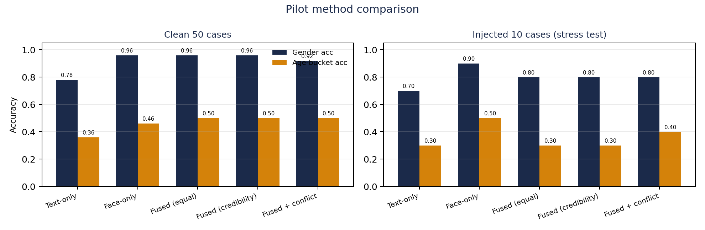
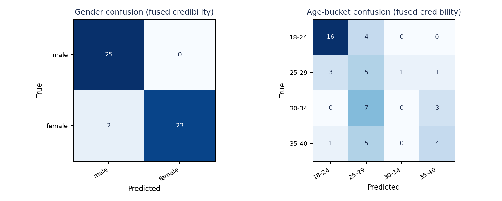
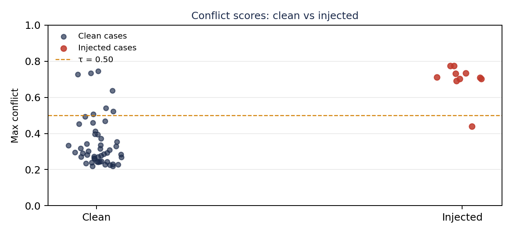
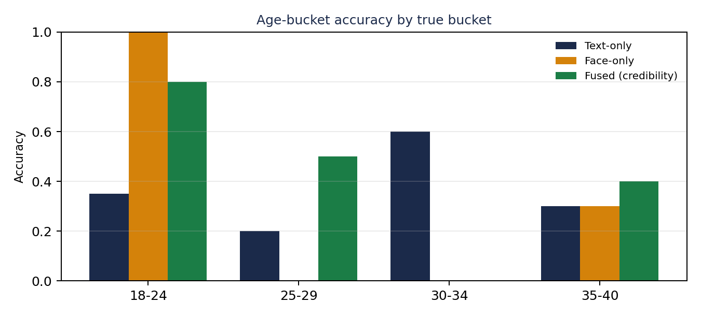
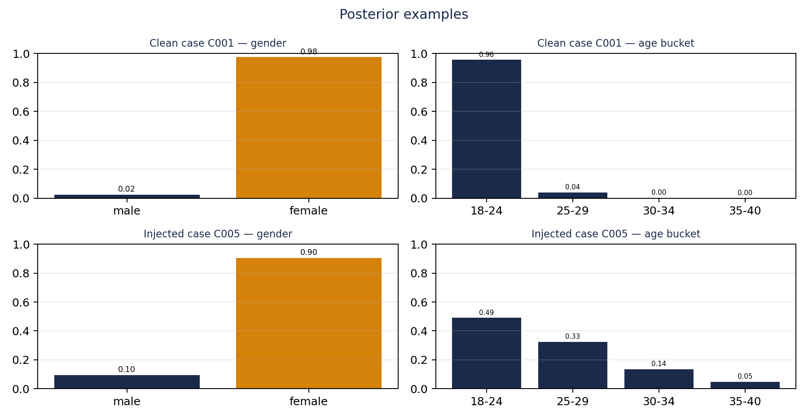
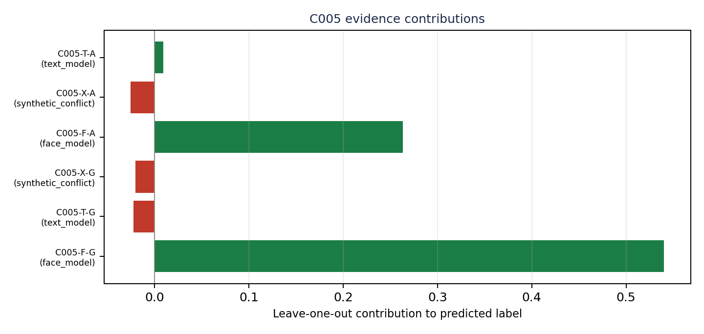
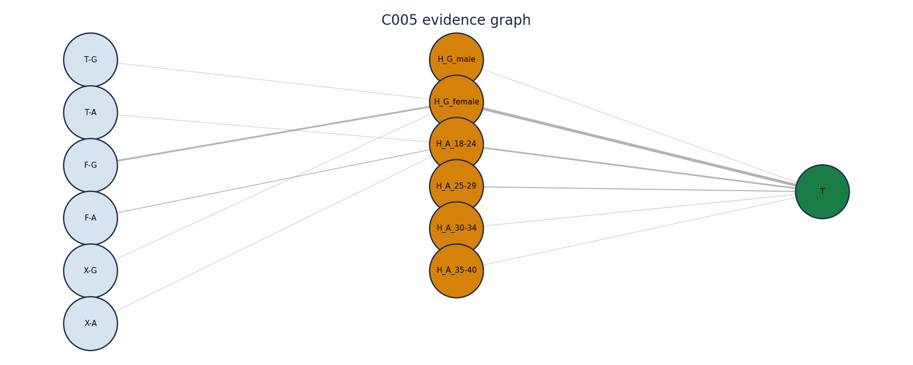
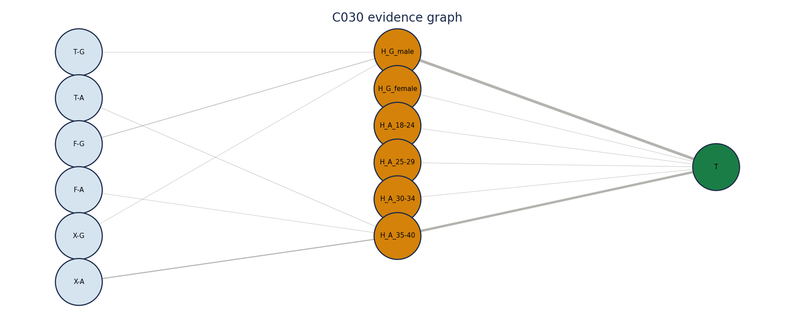

# VIAS 虚实融合身份推断 Pilot Study 报告

**版本**：v0.1  
**日期**：2026-11-24  
**目标变量**：性别、年龄段（代理目标）  
**数据**：SMP CUP 2016（中文微博文本）+ AFAD-Lite（亚洲人脸）  
**代码**：`vias_pilot/`  
**状态**：可行性验证（pilot），不是生产系统

---

## 摘要

- 用 50 个多模态样本（5 个年龄 × 2 种性别 × 5 人）跑通了项目技术路线的五段：**多模态解析 → 统一证据单元 → 六维可信度 → 加权贝叶斯融合 → 冲突处理/可解释**。
- 性别：文本单模态 **0.780**，人脸单模态 **0.960**，融合 **0.960**；人脸是主要贡献，融合与最强单模态持平。
- 年龄：文本单模态 **0.360**，人脸单模态 **0.460**，融合 **0.500**；年龄 MAE 从人脸单模态的 6.36 岁降到融合的 **3.94 岁**，但仍是最大瓶颈。
- 冲突：注入 10 例矛盾证据，检出 **9/10（90%）**；干净样本误报 **7/50（14%）**。冲突处理把注入子集的年龄准确率从 0.30 提到 **0.40**，但把干净子集的性别准确率从 0.96 拉到 **0.92**，说明规则式可信度和冲突阈值还需要校准。
- 结论：**链路能跑通，性别可用，年龄是短板；可信度/冲突处理目前是“能工作但不够准”，下一版应优先改年龄模型、概率校准和可信度学习。**

---

## 1. 目标与范围

### 1.1 目标

验证实施方案 1.1.1.2 的五段技术路线在一个小规模、可控的多模态数据上能否端到端跑通，并拿到第一版基线指标：

1. 多模态数据接入与解析；
2. 统一证据单元；
3. 六维证据可信度评估；
4. 层次贝叶斯（简化版）融合；
5. 冲突处理与可解释呈现。

### 1.2 范围

| 在范围内 | 不在范围内 |
|---|---|
| 文本 + 人脸两种模态 | 音频、行为日志 |
| 性别、年龄段两个代理目标 | 真实身份、候选身份集合 |
| 50 个合成多模态样本 | 30 例真实案件 |
| 规则式六维可信度 | 学习式来源可靠度 |
| 加权对数意见池（简化贝叶斯） | 完整层次贝叶斯网络 |
| 置信度加权 D-S 冲突 | 完整 D-S 组合规则 |
| leave-one-out 贡献度 + 证据图 | 前端界面、LLM 解析 |

**关键说明**：本 pilot 的多模态样本是“同年龄、同性别”的文本用户与 AFAD 人脸**配对**而成，不是同一个真实人。它验证的是“属性证据融合”链路，不是“账号→真实身份”的链路。报告中的 ground truth 是属性标签，不是真实身份。

---

## 2. 数据与样本

### 2.1 SMP CUP 2016（中文文本）

- 3,200 个带标签用户；过滤到 18–40 岁且有文本后，得到 **2,874** 个用户。
- 标签：`gender`（m/f）、`birthday`（出生年）、`location`（省市）。
- 文本：用户历史微博拼接，空格分词后做了轻量 detokenize；单用户字符数 min/median/max = **2,594 / 8,524 / 16,356**。
- 划分：**2,824** 个训练用户，**50** 个 pilot 用户（pilot 用户不参与文本模型训练，避免泄漏）。
- Pilot 分层：年龄 **22/24/28/32/36**，每个年龄 5 男 5 女。

### 2.2 AFAD-Lite（亚洲人脸）

- AFAD 全量 164,432 张亚洲人脸，年龄 15–40，含性别；本 pilot 用 **AFAD-Lite**（60,000 张，18–39 岁）。
- 目录结构 `AFAD-Lite/<age>/<111|112>/`；通过抽样目视核验：**111 = 男，112 = 女**。
- Pilot 从 **22/24/28/32/36** 每个年龄、每种性别各取 5 张，共 50 张（另抽了 20 岁的 10 张备用）。
- 人脸模型为公开预训练模型，不针对 AFAD 微调；年龄模型输出 9 个粗年龄段，再映射到 4 个目标段。

### 2.3 配对方式与 ground truth

- 对每个 SMP 用户，配一张**同年龄、同性别**的 AFAD 人脸。
- Ground truth：性别 = SMP 标签；年龄 = `2016 − 出生年`；年龄段 = 18–24 / 25–29 / 30–34 / 35–40。
- 局限：文本用户和人脸不是同一个人；本 pilot 不验证“同一人”假设，只验证“多源属性证据融合”。

### 2.4 30 例合成案件包

- `cases_synthetic/`：从 50 个 pilot 样本中按年龄 × 性别各取 3 例，共 **30 例**（20 干净 + 10 注入冲突）。
- 每例包含 `case.json`、`text.txt`（脱敏/截断）、`face.jpg`、`evidence_units.jsonl`、`result.json`、`case_card.md`。
- **这不是 30 例真实案件**，只是 10 月计划“30 例样例案件”的结构占位；真实案件仍需示范单位脱敏样本。
- 这个 30 例子集上的结果：性别 **26/30（86.7%）**，年龄段 **16/30（53.3%）**。

---

## 3. 技术路线实现

### 3.1 总流水线

```
SMP 文本 ──> 文本性别/年龄模型 ─┐
SMP 自述 ──> 正则自述证据      ├─> 统一证据单元 ─> 六维可信度 ─> 加权融合 ─> 冲突处理 ─> 可解释
AFAD 人脸 ─> 人脸性别/年龄模型 ─┘
```

### 3.2 单模态模型

| 模态 | 模型 | 性别 | 年龄 |
|---|---|---|---|
| 文本 | TF-IDF 字符 1–3 gram + LogisticRegression | Acc **0.780** / F1 **0.773** | Acc **0.360** / F1 **0.346** |
| 人脸 | ViT（`rizvandwiki/gender-classification`、`nateraw/vit-age-classifier`） | Acc **0.960** / F1 **0.960** | Acc **0.460** / F1 **0.245** |
| 自述 | 正则（“我今年24”“1994年出生”“我是女生”等） | 覆盖 **0%** | 覆盖 **22%** |

文本年龄弱、人脸年龄粗，是后面融合和冲突处理的主要背景。

### 3.3 统一证据单元

每条证据统一为 `EvidenceUnit`（`src/schema.py`），核心字段：

| 字段 | 说明 |
|---|---|
| `evidence_id` / `case_id` | 证据 ID、案件 ID |
| `modality` | text / image / metadata |
| `source_type` | text_model / face_model / self_report / synthetic_conflict |
| `source_name` | 具体模型或规则 |
| `content` | 文本片段、图片路径、自述片段等 |
| `gender_probs` / `age_probs` | 对性别 / 年龄段的概率分布 |
| `credibility` | 六维分数、综合分、权重 |
| `conflict_flag` / `conflict_degree` | 冲突标记与冲突度 |
| `injected` | 是否为人工注入的矛盾证据 |
| `weight_multiplier` | 冲突处理后的降权系数 |

示例（注入的矛盾性别证据）：

```json
{
  "evidence_id": "C005-X-G",
  "case_id": "C005",
  "modality": "text",
  "source_type": "synthetic_conflict",
  "source_name": "injected contradictory self-report",
  "content": {"injected": true, "claimed_gender": "male"},
  "gender_probs": {"male": 0.85, "female": 0.15},
  "age_probs": null,
  "credibility": {
    "source_reliability": 0.68,
    "authority": 0.72,
    "objectivity": 0.55,
    "timeliness": 0.80,
    "completeness": 0.60,
    "consistency": 0.50,
    "score": 0.639,
    "weight": 0.639
  },
  "injected": true,
  "weight_multiplier": 1.0,
  "effective_weight": 0.639
}
```

### 3.4 六维可信度

六个维度与权重：

| 维度 | 权重 | 说明 |
|---|---|---|
| 来源可靠度 | 0.20 | 数据来源本身的可信程度 |
| 权威性 | 0.15 | 来源的权威/正式程度 |
| 客观性 | 0.20 | 是否为主观陈述 |
| 时效性 | 0.15 | 与案件时间的接近程度 |
| 完整性 | 0.15 | 文本长度/图像质量/字段完整度 |
| 一致性 | 0.15 | 与其他证据的一致程度（冲突后更新） |

基础分（`src/credibility.py`）：

| 来源 | 来源 | 权威 | 客观 | 时效 | 完整 | 一致 |
|---|---|---|---|---|---|---|
| 文本模型 | 0.65 | 0.60 | 0.75 | 0.85 | 0.40–1.00（按文本长度） | 0.70 |
| 自述 | 0.75 | 0.80 | 0.45–0.70 | 0.85 | 0.50–1.00（按置信度） | 0.70 |
| 人脸模型 | 0.70 | 0.65 | 0.85 | 0.80 | 0.70–0.80 | 0.70 |
| 注入矛盾 | 0.68 | 0.72 | 0.55 | 0.80 | 0.60 | 0.50 |

综合分：`score = Σ w_d × dim_d`；有效权重：`ω_i = score × weight_multiplier`。

### 3.5 加权贝叶斯融合

对性别和年龄段分别融合。设先验 `P(H)`（性别 0.5/0.5，年龄段 0.25×4），证据 `E_i` 给出 `P_i(H)`，有效权重 `ω_i`：

```
log P(H | E_1..E_n) ∝ log P(H) + Σ_i ω_i × log P_i(H)
```

归一化后得到 `P(gender)` 和 `P(age_bucket)`；最终目标是两个属性的组合。该式是项目“加权贝叶斯”的简化实现，模型输出的后验被当作似然的近似；报告在“局限”里明确这一点。

### 3.6 冲突处理与权重迭代

对两个证据分布 `p`、`q`：

```
K = 1 − Σ_h p(h) q(h)                  # D-S 冲突质量
C = K × min(max(p), max(q))            # 置信度加权冲突
```

乘以 `min(max p, max q)` 是为了避免“两个都不确定但分布不同”被误判为冲突。阈值 `τ = 0.50`。

处理流程：

1. 找当前最大冲突对；
2. 若 `C > τ`，对**有效权重较低**的一方乘以 `0.25`；
3. 该证据的 `consistency` 更新为 `1 − C`，重算综合分；
4. 每对证据只处理一次，避免把双方都降权导致后验退回先验；
5. 最多 3 轮。

### 3.7 可解释性

- **线索影响分析**：对每条证据做 leave-one-out，计算 `贡献 = P(预测标签 | 全部) − P(预测标签 | 去掉该证据)`；取绝对值 Top-3。
- **证据链图**：节点为证据、性别/年龄假设、目标；边为支持/矛盾关系与后验权重；每个案件输出 `outputs/evidence_graphs/<case>.json`，并渲染示例图。
- **逐案结果**：`outputs/case_results_clean.jsonl`、`outputs/case_results_injected.jsonl`。

### 3.8 音频/行为预留接口

- `src/parsers/audio_stub.py`：接收 `audio_uri` / `asr_text` / `speaker_id` / `duration_sec`，返回 `modality="audio"` 的占位证据；`content.status="reserved"`，不带概率。
- `src/parsers/behavior_stub.py`：接收 `log_uri` / `events` / `platform` / `subject_id`，返回 `modality="behavior"` 的占位证据。
- 两者都不参与融合；`src/check_stubs.py` 做接口自检。后续接 ASR/声纹/行为序列模型时，不需要改 Schema 和融合层。

---

## 4. 结果

### 4.1 干净场景（50 例，无注入）

| 方法 | 性别 Acc | 性别 F1 | 年龄 Acc | 年龄 F1 | 年龄 MAE |
|---|---|---|---|---|---|
| 文本单模态 | 0.780 | 0.773 | 0.360 | 0.346 | 4.62 |
| 人脸单模态 | **0.960** | **0.960** | 0.460 | 0.245 | 6.36 |
| 融合（等权） | **0.960** | **0.960** | **0.500** | 0.392 | **3.94** |
| 融合（可信度加权） | **0.960** | **0.960** | **0.500** | 0.392 | **3.94** |
| 融合 + 冲突处理 | 0.920 | 0.919 | **0.500** | **0.394** | 3.98 |

**解读**：
- 性别上，人脸模型已经很强，融合与它持平；文本没有带来额外收益。
- 年龄上，融合把准确率从 0.46 提到 0.50，MAE 从 6.36 降到 3.94，说明多源融合有价值，但绝对水平仍低。
- 可信度加权与等权结果相同，说明当前规则式可信度的区分度不够；这是下一版要改的地方。
- 冲突处理在干净集上把性别从 0.96 拉到 0.92，说明它会在“自然分歧”上误伤；年龄不变。





### 4.2 注入矛盾场景（10 例注入）

| 方法 | 性别 Acc | 性别 F1 | 年龄 Acc | 年龄 F1 | 年龄 MAE |
|---|---|---|---|---|---|
| 文本单模态 | 0.700 | 0.670 | 0.300 | 0.225 | 5.45 |
| 人脸单模态 | **0.900** | **0.899** | **0.500** | **0.292** | 6.30 |
| 融合（等权） | 0.800 | 0.792 | 0.300 | 0.167 | 7.60 |
| 融合（可信度） | 0.800 | 0.792 | 0.300 | 0.167 | 7.60 |
| 融合 + 冲突处理 | 0.800 | 0.792 | 0.400 | 0.200 | **6.70** |

**解读**：
- 注入的矛盾证据确实把融合结果拉低了（等权融合年龄 0.50 → 0.30），说明冲突处理是必要的。
- 冲突处理把注入子集的年龄从 0.30 拉回 0.40，MAE 从 7.60 降到 6.70；但性别没有提升，因为人脸性别证据本身很强，融合本来就不容易被单条注入证据翻掉。
- 冲突处理仍达不到人脸单模态的 0.50，说明“降权”还不够精准；部分注入证据在真实证据较弱时仍然占主导。

### 4.3 冲突检测

| 指标 | 值 |
|---|---|
| 阈值 τ | 0.50 |
| 注入案例 | 10 |
| 检出 | **9 / 10 = 90%** |
| 干净集误报 | **7 / 50 = 14%** |
| 注入子集性别正确 | 80% |
| 注入子集年龄正确 | 40% |
| 注入子集两者都正确 | 40% |



**敏感性**（τ 与降权系数）：

| τ | 降权 | 干净性别 | 干净年龄 | 注入性别 | 注入年龄 | 检出率 | 误报率 |
|---|---|---|---|---|---|---|---|
| 0.50 | 0.25 | 0.92 | 0.50 | 0.80 | **0.40** | 90% | 14% |
| 0.55 | 0.35 | 0.92 | 0.50 | 0.80 | 0.30 | 90% | **8%** |
| 0.60 | 0.35 | 0.92 | 0.50 | 0.80 | 0.30 | 90% | **8%** |
| 0.60 | 0.50 | 0.92 | 0.50 | 0.80 | 0.30 | 90% | **8%** |

**结论**：τ=0.50/降权 0.25 对注入年龄最友好，但误报 14%；τ=0.55/降权 0.35 误报降到 8%，但注入年龄回落到 0.30。Pilot 默认取前者，因为它更能暴露冲突处理的行为；工程上建议先取后者，等可信度校准后再放宽。

### 4.4 分年龄段准确率



- 18–24 段最好（文本/人脸都相对容易）。
- 25–29、30–34、35–40 段混淆严重；人脸年龄模型绝大多数输出 20–29，导致 30 岁以上被低估。
- 这是“年龄段边界 + 人脸模型粗粒度”共同造成的，不是融合逻辑的问题。

---

## 5. 案例分析

### 5.1 C001：干净、正确

- 真实：female / 18–24。
- 性别：文本模型 female **0.848**，人脸模型 female **0.960**，融合后 female **0.975**。
- 年龄：文本模型 18–24 **0.589**，人脸模型 18–24 **0.611**，自述证据 18–24 **0.85**，融合后 18–24 **0.958**。
- Top 证据：性别是人脸（贡献 +0.191）> 文本（+0.059）；年龄是自述（+0.215）> 人脸（+0.069）。
- 说明：当人脸清晰、性别特征明显时，融合主要靠人脸；文本是弱 corroboration；年龄上自述证据的贡献最大。



### 5.2 C005：注入冲突、正确恢复

- 真实：female / 18–24；注入的证据声称 male / 30–34。
- 性别冲突 **0.71**，年龄冲突 **0.52**；两条注入证据都被降权到 0.25。
- 最终 female **0.90**、18–24 **0.49**，恢复正确。
- Top 证据：人脸性别（+0.54）、人脸年龄（+0.26）；注入性别/年龄的贡献为负。





### 5.3 C030：注入年龄未检出、失败

- 真实：male / 25–29；注入证据声称 35–40。
- 年龄冲突只有 **0.27**（低于 τ），没有触发降权；最终预测 35–40。
- 原因：文本年龄证据弱、人脸年龄证据也不确定；注入证据置信度高（0.85），在融合中占主导。
- 教训：**冲突检测要求至少两个“有信心”的来源**；当真实证据都弱时，单条高置信错误证据可以绕过检测。



### 5.4 C045：强模型错误 + 降权错对象

- 真实：female / 35–40；人脸性别模型错误地给出 male；注入证据也声称 male。
- 冲突处理把**文本性别证据**（可能是正确的 female）降权了，因为它的权重低于人脸 + 注入的组合；最终预测 male / 25–29。
- 教训：当最强模型本身错误时，基于权重的降权会“帮倒忙”；需要模型校准、来源可靠度学习，或引入第三源交叉验证。

---

## 6. 错误分析

### 6.1 年龄是主瓶颈

- 人脸年龄模型输出 9 段，pilot 中 40/50 的 top 段是 20–29；30–34 岁被明显低估（7/10 预测成 25–29），35–40 岁部分被低估（5/10 预测成 25–29）。
- 文本年龄模型只有 0.36；自述年龄覆盖 22%，大部分用户没有明确自述。
- 结果：25–29 / 30–34 / 35–40 三段互相混淆；18–24 相对最好。
- 改进优先级最高：**换更细的年龄模型/回归、在 AFAD 上微调、做概率校准**。

### 6.2 性别：人脸强，文本弱

- 人脸 0.96，文本 0.78；融合等于人脸，文本没有增量。
- 当人脸错误时（C045），文本本可以纠正，但被冲突处理降权；说明“可信度权重”不能简单按来源固定，需要按样本质量动态估计（模糊、遮挡、侧脸）。
- 自述性别覆盖 0%，正则太严或用户不披露；需要更好的抽取（LLM/规则组合）。

### 6.3 可信度区分度不足

- 等权融合与可信度加权结果完全一致；六维规则的分差太小，无法改变后验。
- 当前分数是“拍脑袋规则”，没有用验证集校准；下一版应做 **source reliability learning**（EM/truth discovery）或至少按模态准确率设置权重。

### 6.4 冲突处理的副作用

- 干净集误报 14%；冲突处理把干净性别从 0.96 拉到 0.92。
- 原因：自然分歧（文本 vs 人脸）被当成冲突，且低权重一方可能是正确的。
- 改进：属性-specific τ、按置信度/质量门控、只在“两个来源都高置信且矛盾”时触发；降权系数不要一刀切。

---

## 7. 局限

1. **样本小**：50 例 pilot + 30 例合成案件包；每个年龄/性别只有 5 例；指标置信区间很宽，不能当最终结论。
2. **合成配对**：文本用户和人脸不是同一个人；没有验证“同一人”假设，也没有真实身份候选集；`cases_synthetic/` 的 30 例也是合成案件，不是真实案件。
3. **人脸模型非中文专用**：ViT 年龄/性别模型主要在西方数据上训练；对亚洲人脸、年龄段的偏差可能较大。
4. **年龄段粗**：4 段，且人脸模型原始输出 9 段；边界和映射都会影响结果。
5. **没有 LLM 解析**：文本/图像解析用的是轻量模型和正则；项目完整路线中的“大模型结构化”没有实现。
6. **没有音频/行为日志**：只覆盖文本 + 图像。
7. **可信度是规则**：没有学习、没有校准；六维分数的区分度不足。
8. **没有统计检验**：50 例上的 2–4 个百分点差异不显著；报告只把它当基线。
9. **没有前端/演示**：输出是 JSONL、图表和 Markdown。

---

## 8. 下一步

### 8.1 模型

- **年龄**：在 AFAD/MegaAge 上微调一个年龄回归/分段模型；或换更强的人脸年龄模型；做温度校准/Platt scaling。
- **文本**：中文 BERT/ RoBERTa 替代 TF-IDF；加入自述抽取的 LLM/规则组合；提升自述覆盖率。
- **性别**：人脸模型按图像质量（模糊、遮挡、侧脸）输出质量分，作为可信度输入。

### 8.2 可信度与冲突

- 用验证集学习每个来源的可靠度（truth discovery / EM），替代拍脑袋规则。
- 属性-specific τ：性别和年龄的证据粒度不同，不应共用一个阈值。
- 冲突触发条件加入“双方置信度都 ≥ 0.6”和“来源质量分 ≥ 0.5”，降低干净集误报。
- 降权系数按冲突强度连续调整，而不是固定 0.25。

### 8.3 数据与任务

- 扩到 30 例真实案件（示范单位脱敏样本），加入候选身份集合，验证“账号→真实身份”而不是属性代理。
- 加入音频 ASR、行为日志，至少各 1 条样例链路。
- 用 LLM 做证据结构化（实体/事件/属性抽取），替换当前轻量解析。

### 8.4 工程

- 把 `pipeline.py` 封装成服务/CLI；输出一页可解释报告（PDF/HTML）。
- 建一个最小前端：案件列表、证据单元、后验排序、证据链图。
- 补单元测试和回归测试（当前只有端到端脚本）。

---

## 9. 复现

```bash
cd vias_pilot

# 1. SMP 2016 数据（已放在 data/raw/smp）
python src/prepare_smp.py

# 2. 构建 50 个多模态样本（需要 AFAD-Lite 采样图）
python src/build_cases.py

# 3. 文本模型
python src/text_model.py

# 4. 人脸模型（首次运行会下载 ViT 权重；需要网络/代理）
python src/face_model.py

# 5. 证据链 + 冲突 + 可解释
python src/pipeline.py --tau 0.50 --downweight 0.25

# 6. 图表
python src/make_figures.py

# 7. 音频/行为预留接口自检
python src/check_stubs.py

# 8. 30 例合成案件包
python src/build_case_packages.py
```

**主要输出**：

| 文件 | 内容 |
|---|---|
| `outputs/evidence_units_clean.jsonl` | 干净场景的证据单元 |
| `outputs/evidence_units_injected.jsonl` | 注入场景的证据单元 |
| `outputs/case_results_clean.jsonl` | 干净场景逐案结果、后验、Top 证据 |
| `outputs/case_results_injected.jsonl` | 注入场景逐案结果、冲突日志 |
| `outputs/evidence_graphs/*.json` | 证据链图数据 |
| `outputs/metrics.json` | 全部指标 |
| `outputs/figures/*.png` | 报告图表 |
| `reports/text_model_metrics.json` | 文本模型指标 |
| `reports/face_model_metrics.json` | 人脸模型指标 |
| `cases_synthetic/` | 30 例合成案件包（20 干净 + 10 注入） |
| `schema/evidence_unit.schema.json` | 证据单元 JSON Schema v0.1 |
| `reports/evidence_unit_v0.1_review.md` | Schema 一页评审稿 |
| `src/parsers/` | audio/behavior 预留接口 |
| `deploy/docker-compose.yml` | PostgreSQL 14 + MinIO + Redis |

**数据说明**：AFAD-Lite 原始归档约 865 MB（27 个分卷），采样后保留 **60 张图**（pilot 用其中 50 张）；如需重采样，按 `data/raw/afad/README.txt` 的 `restore.sh` 恢复归档，再运行 `src/extract_afad_samples.py`。SMP 2016 原始文件约 79 MB，已保留。

---

## 附录 A：证据单元字段说明

见 `src/schema.py` 的 `EvidenceUnit` / `Credibility`。

## 附录 B：关键文件清单

```
vias_pilot/
├── src/
│   ├── schema.py                 # 证据单元
│   ├── credibility.py            # 六维可信度
│   ├── fusion.py                 # 融合 + 冲突
│   ├── pipeline.py               # 端到端
│   ├── prepare_smp.py            # SMP 解析/划分
│   ├── build_cases.py            # 多模态配对
│   ├── extract_afad_samples.py   # AFAD 采样
│   ├── text_model.py             # 文本模型
│   ├── face_model.py             # 人脸模型
│   └── make_figures.py           # 图表
├── data/processed/               # 训练/ pilot CSV
├── models/                       # 文本模型
├── outputs/                      # 证据单元、结果、指标、图
└── reports/                      # 本报告 + 模型指标
```
