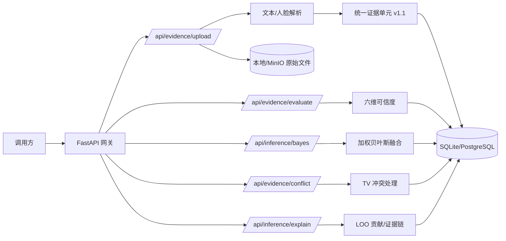

# VIAS 虚实融合身份推断系统 API 方案说明

**版本**：1.0  
**日期**：2026-11-25  
**定位**：从 pilot 脚本升级为可部署、可持久化、可审计的完全体服务  
**参考**：《课题一能力 API 技术方案 v0.4》的接口设计原则（显式参数、白名单校验、结构化错误、可追溯记录、能力边界 422），不复制其方法仓库语义。  
**配套**：[项目书要求对照](PROJECT_REQUIREMENTS.md)、[架构说明](ARCHITECTURE.md)、[质量报告](QUALITY_REPORT.md)。

---

## 1. 目标与范围

### 1.1 目标

把“多模态证据 → 统一证据单元 → 六维可信度 → 层次贝叶斯 → 冲突处理 → 可解释”这条链路封装成五个稳定的 HTTP 能力接口，供其他课题组、业务系统和前端调用。

### 1.2 完全体包含

- 五个正式 API（图片中的五个接口）；
- 目标身份层：`target=identity`，输出候选身份后验排序；
- 证据、案件、推断、冲突、解释的持久化；
- 原始文件落盘、`raw_ref` 追溯、SHA-256；
- 六维可信度评估与覆盖参数；
- 加权对数意见池（层次贝叶斯简化实现）；
- TV 冲突检测、低权证据降权、冲突日志；
- Leave-one-out 贡献、Top-k 证据、证据链、中文解释；
- 参数白名单、统一错误码、请求 ID、API Key、上传大小限制；
- OpenAPI/Swagger 文档、端到端测试；
- 本地文件存储/SQLite 默认后端，后续可替换 PostgreSQL/MinIO。

### 1.3 不包含/边界

- 不输出“真实身份”，输出性别/年龄段后验；
- 人脸模型默认关闭，可开启或由调用方传入概率；
- 音频：调用方提供 ASR 文本时可走属性模型；没有内置 ASR/声纹；行为只做事件特征，不产出身份概率；
- 不包含真实案件 ground truth、示范单位审批流；
- 当前模型仍是 pilot 训练的基线模型，不能宣称生产级精度。

---

## 2. 参考方案如何映射

| 参考方案做法 | 本系统落地 |
|---|---|
| 显式 `capability_id` 指定能力 | 五个固定路径；请求体显式 `case_id`、`source_type`、`attribute` |
| 参数白名单，多传/少传返回 400 | Pydantic 模型 + `extra` 校验；未知字段返回 `INVALID_REQUEST` |
| 方法直调/维度绑定两种入口 | 本系统统一为“能力路径”，不做方法目录；`attribute` 区分性别/年龄/两者 |
| 结果带 `binding`、`method_id` 等可追溯字段 | 返回 `evidence_id`、`inference_id`、`conflict_id`、`explanation_id` |
| 能力边界不满足返回 422 | 无概率证据、无解释结果、候选集缺失返回 422/400 |
| 统一错误码 | `INVALID_REQUEST`、`EVIDENCE_NOT_FOUND`、`INVALID_PROBABILITIES`、`NO_PROBABILITY_EVIDENCE` 等 |
| 任务/记录可查询 | `GET /api/cases/{id}`、`GET /api/evidence/{id}`、`GET /api/inferences/{id}` |
| 媒体文件经网关 | 本系统用 `raw_ref` + 受控本地存储；可替换 MinIO |

---

## 3. 总体架构



### 3.1 分层

| 层 | 目录 | 职责 |
|---|---|---|
| API | `src/vias/api/` | 路由、参数解析、依赖注入 |
| Service | `src/vias/services/` | 证据、推断、冲突、解释业务 |
| Core | `src/vias/core/` | Schema、可信度、融合、文本/人脸解析 |
| Repository | `src/vias/repository.py` | 案件/证据/推断/解释持久化 |
| Storage | `src/vias/storage.py` | 原始文件落盘、哈希、`raw_ref` |
| DB | `src/vias/db.py` | SQLite schema、连接、WAL |

---

## 4. 数据模型：统一证据单元 v1.1

23 个字段，Pydantic + JSON Schema 双重校验；`extra=forbid`；概率键必须精确且和为 1。

| 组 | 字段 | 约束 |
|---|---|---|
| 标识 | `schema_version`、`evidence_id`、`case_id` | 版本 1.0；ID 案件内唯一 |
| 来源 | `modality`、`source_type`、`source_name` | 枚举；名称非空 |
| 内容 | `content`、`raw_ref`、`time_range`、`language` | 模态相关；时间仅 start/end |
| 概率 | `gender_probs`、`age_probs` | 键精确；0–1；和为 1 |
| 候选身份 | `identity_probs` | candidate_id → 概率；和为 1 |
| 可信度 | `credibility` | 六维 + score + weight，均 0–1 |
| 关系/冲突 | `supports`、`contradicts`、`conflict_flag`、`conflict_degree` | 冲突度 0–1 |
| 合规/权重 | `injected`、`synthetic`、`pii_redacted`、`weight_multiplier` | 权重 (0,1] |
| 说明 | `note` | 处理备注 |

**来源类型**：`text_model`、`face_model`、`self_report`、`audio_stub`、`behavior_stub`、`synthetic_conflict`、`metadata`。

**完整字段约束**：`docs/evidence_unit_spec_v1.1.md`；机器可读：`vias_system/src/vias/core/schema.py`。

---

## 5. 五个 API

### 5.1 总览

| 方法 | 路径 | 作用 |
|---|---|---|
| POST | `/api/evidence/upload` | 多模态证据数据接入 |
| POST | `/api/evidence/evaluate` | 证据可信度评估 |
| POST | `/api/inference/bayes` | 层次贝叶斯：属性后验 / 候选身份后验 |
| POST | `/api/evidence/conflict` | 证据冲突处理 |
| POST | `/api/inference/explain` | 可解释性溯源查询 |

所有 `/api/*` 支持可选 `X-API-Key`；响应带 `X-Request-ID` 和 `X-Process-Time-Ms`。

---

### 5.2 证据接入：`POST /api/evidence/upload`

支持 `multipart/form-data` 和 `application/json`。

**multipart 字段**

| 字段 | 必填 | 说明 |
|---|---|---|
| `case_id` | 是 | 案件 ID |
| `modality` | 是 | text / image / audio / behavior / metadata |
| `source_type` | 是 | 见上 |
| `source_name` | 是 | 模型/规则/设备名 |
| `text` | 否 | 文本内容；text 模态可直接给 |
| `file` | 否 | 原始文件 |
| `content` / `metadata` | 否 | JSON 字符串，模态附加字段 |
| `gender_probs` / `age_probs` | 否 | JSON 字符串；不传则尝试内置模型 |
| `identity_probs` | 否 | 候选身份概率 JSON 字符串：`{"cand_a":0.8,"cand_b":0.2}` |
| `time_range` | 否 | `{"start": "...", "end": "..."}` |
| `language` | 否 | 如 `zh` |
| `synthetic` / `pii_redacted` / `injected` | 否 | 数据性质标记 |
| `request_id` | 否 | 追踪键；写入审计日志 |

**JSON 字段**：同上；文件可用 `file_base64` + `filename`。

**示例**

```bash
curl -X POST http://127.0.0.1:8000/api/evidence/upload \
  -F "case_id=CASE-001" \
  -F "modality=text" \
  -F "source_type=text_model" \
  -F "source_name=tfidf_lr" \
  -F "text=我今年28岁，是一名女生。" \
  -F "gender_probs={\"male\":0.1,\"female\":0.9}" \
  -F "age_probs={\"18-24\":0.05,\"25-29\":0.8,\"30-34\":0.1,\"35-40\":0.05}"
```

**响应 201**

```json
{
  "evidence_id": "ev_...",
  "case_id": "CASE-001",
  "status": "ready",
  "modality": "text",
  "source_type": "text_model",
  "schema_version": "1.0",
  "raw_ref": "local://CASE-001/ev_.../note.txt",
  "content_snippet": "我今年28岁，是一名女生。",
  "probabilities": {
    "gender": {"male": 0.1, "female": 0.9},
    "age": {"18-24": 0.05, "25-29": 0.8, "30-34": 0.1, "35-40": 0.05}
  },
  "credibility": {"score": 0.66, "weight": 0.66, "...": "六维"},
  "storage": {"bytes": 42, "sha256": "..."}
}
```

**解析规则**

- 文本：优先使用客户端概率；否则加载 `models/` 的 TF-IDF + LR；模型缺失时回退到自述正则；
- 人脸：客户端概率优先；`VIAS_ENABLE_FACE_MODEL=1` 时本地加载 ViT；
- 音频：`content.asr_text` 存在时走文本模型；否则 `status=reserved`；
- 行为：解析事件数/类型/IP/设备，暂不产出身份概率；
- 文本默认做 URL/邮箱/@/手机号/证件号/长数字脱敏，`pii_redacted=true`。

---

### 5.3 可信度评估：`POST /api/evidence/evaluate`

```json
{
  "case_id": "CASE-001",
  "evidence_ids": ["ev_..."],
  "overrides": {
    "ev_...": {"authority": 0.9, "objectivity": 0.8}
  }
}
```

- 不传 `evidence_ids`：评估案件下全部证据；
- `overrides` 只允许六维键；`score/weight` 自动重算；
- 返回每条证据的六维、`score`、`weight`、`effective_weight`。

**响应**

```json
{
  "case_id": "CASE-001",
  "evaluated": [
    {
      "evidence_id": "ev_...",
      "source_type": "text_model",
      "credibility": {
        "source_reliability": 0.65, "authority": 0.6, "objectivity": 0.75,
        "timeliness": 0.85, "completeness": 0.4, "consistency": 0.7,
        "score": 0.6625, "weight": 0.6625
      },
      "effective_weight": 0.6625
    }
  ]
}
```

---

### 5.4 层次贝叶斯推理：`POST /api/inference/bayes`

```json
{
  "case_id": "CASE-001",
  "attribute": "both",
  "evidence_ids": null,
  "prior": null,
  "weight_power": 1.5
}
```

- `attribute`：`gender` / `age` / `both`；
- 融合公式：`log P(H|E) ∝ log P(H) + Σ ω_i log P_i(H)`；
- `ω_i = (credibility.weight × weight_multiplier) ^ weight_power`；
- `weight_power=1.5` 为默认“可信度对比度”：增强高可信证据，pilot 上注入子集年龄 0.30→0.40；
- 先验默认性别 0.5/0.5，年龄四段各 0.25；可用 `prior` 覆盖（单属性时）。

**响应**

```json
{
  "inference_id": "inf_...",
  "case_id": "CASE-001",
  "attribute": "both",
  "weight_power": 1.5,
  "results": {
    "gender": {
      "posterior": {"male": 0.19, "female": 0.81},
      "prediction": "female",
      "confidence": 0.81,
      "n_evidence": 2,
      "prior": {"male": 0.5, "female": 0.5}
    },
    "age": {
      "posterior": {"18-24": 0.10, "25-29": 0.64, "30-34": 0.16, "35-40": 0.10},
      "prediction": "25-29",
      "confidence": 0.64,
      "n_evidence": 2,
      "prior": {"18-24": 0.25, "25-29": 0.25, "30-34": 0.25, "35-40": 0.25}
    }
  },
  "used_evidence": [
    {"evidence_id": "ev_...", "weight": 0.66, "attribute": "gender"}
  ]
}
```

`inference_id` 用于后续解释查询。

---

### 5.5 冲突处理：`POST /api/evidence/conflict`

```json
{
  "case_id": "CASE-001",
  "attribute": "both",
  "tau": null,
  "tau_gender": 0.65,
  "tau_age": 0.50,
  "downweight": 0.25,
  "max_rounds": 3,
  "weight_power": 1.5,
  "persist": true
}
```

- `TV = 0.5 × Σ |p(h) − q(h)|`；`C = TV × min(max p, max q)`；相同分布冲突为 0；
- 默认阈值：gender `τ=0.65`、age `τ=0.50`；显式传 `tau` 时对两个属性统一覆盖；
- `C > τ` 时对低有效权重证据 `weight_multiplier *= downweight`；
- 被降权证据 `consistency = 1 − C`，重算可信度；
- 每对证据只处理一次，最多 `max_rounds` 轮；
- `persist=true` 时写回证据的权重/一致性/冲突标记。

**响应**

```json
{
  "conflict_id": "con_...",
  "case_id": "CASE-001",
  "tau": null,
  "taus": {"gender": 0.65, "age": 0.50},
  "weight_power": 1.5,
  "attributes": {
    "gender": {
      "detected": true,
      "max_conflict": 0.72,
      "initial_pair": {"a": "ev_A", "b": "ev_B", "tv": 0.8, "ds": 0.82},
      "rounds": [
        {"round": 1, "evidence_a": "ev_A", "evidence_b": "ev_B",
         "conflict": 0.72, "downweighted": "ev_A", "weight_multiplier": 0.25}
      ],
      "posterior": {"male": 0.24, "female": 0.76},
      "prediction": "female",
      "confidence": 0.76
    }
  },
  "downweighted": ["ev_A"],
  "persisted": true
}
```

---

### 5.6 可解释溯源：`POST /api/inference/explain`

```json
{
  "inference_id": "inf_...",
  "top_k": 3
}
```

也可只传 `case_id`（会新建一次推断）：

```json
{"case_id": "CASE-001", "attribute": "both", "top_k": 3}
```

**响应**

```json
{
  "explanation_id": "exp_...",
  "inference_id": "inf_...",
  "case_id": "CASE-001",
  "results": {
    "gender": {
      "prediction": "female",
      "confidence": 0.81,
      "posterior": {"male": 0.19, "female": 0.81},
      "top_evidence": [
        {
          "evidence_id": "ev_...",
          "source_type": "face_model",
          "weight": 0.66,
          "contribution": 0.336,
          "direction": "support",
          "summary": "face_model evidence"
        }
      ],
      "chain": {
        "nodes": [
          {"id": "target:CASE-001", "type": "target", "label": "CASE-001 · gender = female"},
          {"id": "hypothesis:gender", "type": "hypothesis", "label": "H_gender"},
          {"id": "evidence:ev_...", "type": "evidence", "label": "face_model · ev_..."}
        ],
        "edges": [
          {"source": "hypothesis:gender", "target": "target:CASE-001", "weight": 0.81, "kind": "posterior"},
          {"source": "evidence:ev_...", "target": "hypothesis:gender", "weight": 0.336, "kind": "leave_one_out"}
        ]
      },
      "narrative": "案件 CASE-001 的 gender 融合结果为 female（置信度 0.811）。主要支持证据：ev_...（+0.337）。"
    }
  }
}
```

说明：`contribution = P(预测|全部) − P(预测|去掉该证据)`；正值支持，负值反对。

---

### 5.7 目标身份层：`target=identity`

项目书的最终目标是“目标身份判定 + 候选身份后验排序”，性别/年龄只是中间假设层。`/api/inference/bayes` 增加 `target=identity`：

```json
{
  "case_id": "CASE-001",
  "target": "identity",
  "candidates": [
    {"candidate_id": "cand_a", "display_name": "候选A", "gender": "female", "age_bucket": "25-29"},
    {"candidate_id": "cand_b", "display_name": "候选B", "gender": "male", "age_bucket": "30-34"}
  ],
  "account_a": "platformA:user123",
  "account_b": "platformB:user456",
  "platform": "platformA/platformB",
  "weight_power": 1.5
}
```

两种打分模式：

1. **identity 证据**：证据带 `identity_probs`（candidate_id → 概率），直接加权融合；
2. **attributes 兼容**：候选带性别/年龄，用证据的性别/年龄后验做兼容似然；这是没有真实身份证据时的 pilot 回退。

响应：

```json
{
  "inference_id": "inf_...",
  "case_id": "CASE-001",
  "target": "identity",
  "attribute": "identity",
  "weight_power": 1.5,
  "results": {
    "identity": {
      "prediction": "cand_a",
      "confidence": 0.82,
      "ranking": [
        {"candidate_id": "cand_a", "probability": 0.82},
        {"candidate_id": "cand_b", "probability": 0.18}
      ],
      "mode": "attributes"
    }
  }
}
```

`/api/evidence/conflict` 也支持 `attribute=identity` + `candidates`；`/api/inference/explain` 支持对身份推断做 LOO/Top-k/证据链解释。

**pilot 合成评测**（50 案例、每案 1 真候选 + 4 干扰候选）：Accuracy@1=0.64、Recall@3=0.90；这是候选排序链路验证，不是真实身份识别指标。

---

## 6. 典型调用顺序

```text
1. POST /api/evidence/upload        逐条接入文本/人脸/自述
2. POST /api/evidence/evaluate      六维可信度
3. POST /api/inference/bayes        得到 inference_id 与后验
4. POST /api/evidence/conflict      冲突检测/降权（可选，但推荐）
5. POST /api/inference/bayes        冲突后重跑推断
6. POST /api/inference/explain      用新 inference_id 查解释
```

注意：冲突处理会修改证据权重；如果先解释再冲突，解释对应的是旧推断。

---

## 7. 错误码

| HTTP | code | 场景 |
|---:|---|---|
| 400 | `INVALID_REQUEST` | 参数缺失/类型错误/JSON 非法 |
| 400 | `SOURCE_MODALITY_MISMATCH` | source_type 与 modality 不匹配 |
| 400 | `INVALID_PROBABILITIES` | 概率键错误、越界、和不为 1 |
| 400 | `INVALID_PRIOR` | 先验键/和错误 |
| 400 | `INVALID_OVERRIDE` | 可信度覆盖键/值错误 |
| 401 | `AUTH_INVALID` | 配置了 API Key 但未带/带错 |
| 404 | `CASE_NOT_FOUND` / `EVIDENCE_NOT_FOUND` | 案件/证据不存在 |
| 404 | `INFERENCE_NOT_FOUND` / `EXPLANATION_NOT_FOUND` | 记录不存在 |
| 409 | `EVIDENCE_EXISTS` | evidence_id 冲突 |
| 413 | `PAYLOAD_TOO_LARGE` | 上传超过限制 |
| 415 | `UNSUPPORTED_MEDIA_TYPE` | 非 JSON/multipart |
| 422 | `NO_PROBABILITY_EVIDENCE` | 证据没有可融合概率 |
| 422 | `NO_EXPLANATION` | 没有可解释结果 |
| 500 | `INTERNAL_ERROR` | 未处理异常（不返回堆栈） |

错误体：

```json
{"error": {"code": "NO_PROBABILITY_EVIDENCE", "message": "...", "details": {}, "request_id": "req_..."}}
```

---

## 8. 部署与配置

### 8.1 本地

```bash
cd vias_system
pip install -e .
uvicorn vias.main:app --host 0.0.0.0 --port 8000
```

- Swagger：http://127.0.0.1:8000/docs
- OpenAPI：http://127.0.0.1:8000/openapi.json
- 默认 DB：`vias_system/var/vias.db`
- 默认文件：`vias_system/var/uploads/`

### 8.2 环境变量

| 变量 | 默认 | 说明 |
|---|---|---|
| `VIAS_DB_PATH` | `var/vias.db` | SQLite 路径 |
| `VIAS_STORAGE_DIR` | `var/uploads` | 原始文件目录 |
| `VIAS_TEXT_MODEL_DIR` | `models` | 文本模型目录 |
| `VIAS_ENABLE_FACE_MODEL` | `0` | 是否本地跑 ViT |
| `VIAS_FACE_DEVICE` | `cpu` | `cpu` / `cuda` |
| `VIAS_MAX_UPLOAD_MB` | `25` | 上传上限 |
| `VIAS_API_KEY` | 空 | 设置后 `/api/*` 需 `X-API-Key` |
| `VIAS_CORS_ORIGINS` | 空 | 逗号分隔 |

### 8.3 Docker

```bash
cd vias_system
docker compose up --build
```

`docker-compose.yml` 使用卷 `vias_data` 持久化 DB 和上传文件；人脸模型默认不装，需在镜像中额外安装 `torch/transformers` 并设置环境变量。

### 8.4 生产替换

- SQLite → PostgreSQL：实现 `Repository` 的 PostgreSQL 版本，保持 API 不变；
- 本地文件 → MinIO/S3：替换 `Storage.save`，`raw_ref` 改为 `s3://`；
- 单实例 → 队列：上传后异步解析，加入 `jobs` 表与 worker；
- API Key → 网关 OAuth/mTLS；加审计与限流。

---

## 9. 安全与数据治理

- 原始数据只存受控目录；公共仓库不提交 `var/`、原始文本/人脸；
- 文本默认正则脱敏，仍可能残留可识别信息，需按敏感数据管理；
- 合成案件必须 `synthetic=true`，不得表述为真实身份；
- `raw_ref` 仅返回引用，不在响应中回显全文；
- API Key 可选；生产必须在网关层加 TLS、鉴权、限流；
- 日志不记录全文和人脸路径，只记录 ID/状态；
- 真实案件接入前走示范单位授权与伦理审批。

---

## 10. 测试与验收

```bash
cd vias_system
python -m unittest discover -s tests -v
```

覆盖：

- Schema / 可信度 / 融合 / 文本解析（13 个 core 测试）；
- health / OpenAPI、五接口端到端（上传 → 评估 → 贝叶斯 → 冲突 → 解释）；
- multipart、JSON+base64、内置文本模型、查询、404、未知字段、API Key、上传超限、冲突 persist=false。

当前测试：**36/36 通过**。

---

## 11. 与 pilot 的关系

| 维度 | pilot | 完全体 |
|---|---|---|
| 形态 | 脚本 + JSONL | HTTP 服务 + DB |
| 证据 | 离线生成 | 在线接入、落盘、追溯 |
| 可信度 | 规则函数 | 可评估、可覆盖、持久化 |
| 推断 | 批处理 | 按案件/证据子集调用 |
| 冲突 | 离线 | 在线检测、降权、写回 |
| 解释 | 离线 Top-3/图 | API 查询、证据链、叙述 |
| 数据 | 50 例合成 | 任意案件，空库启动 |
| 部署 | 本地脚本 | uvicorn/Docker |

pilot 的 Schema v1.1、可信度规则、融合/冲突公式被复用；pilot 的 50 例数据不进入服务默认库，避免把演示数据当成生产数据。

---

## 12. 已知限制与下一步

1. **人脸模型默认关闭**：开启需 `torch/transformers` 和模型权重；也可由上游传入概率。
2. **年龄模型仍是 pilot 基线**：4 段、MAE 约 3.94 岁；生产需微调/校准。
3. **可信度是规则分**：未学习来源可靠度；下一步用验证集做 truth discovery/EM。
4. **SQLite 单机**：高并发换 PostgreSQL；当前适合课题组内部/演示。
5. **音频/行为模型**：音频支持 ASR 文本样例链路，无内置 ASR；行为只做特征，不产出概率。
6. **真实身份层未实现**：当前输出性别/年龄段后验，候选身份层留待 v2。

---

## 13. 文件清单

| 路径 | 说明 |
|---|---|
| `vias_system/src/vias/main.py` | FastAPI 应用工厂 |
| `vias_system/src/vias/api/` | 五个接口与查询路由 |
| `vias_system/src/vias/services/` | 证据/推断/冲突/解释服务 |
| `vias_system/src/vias/core/` | Schema、可信度、融合、文本/人脸解析 |
| `vias_system/src/vias/repository.py` | 持久化 |
| `vias_system/src/vias/storage.py` | 文件落盘 |
| `vias_system/models/` | 内置文本模型 |
| `vias_system/tests/test_api.py` | 端到端测试 |
| `vias_system/tests/test_core.py` | Schema/可信度/融合/文本解析测试 |
| `vias_system/schema/` | JSON Schema v1.1 + 示例 |
| `vias_system/scripts/benchmark_conflict.py` | pilot 冲突参数复现 |
| `vias_system/docker-compose.yml` | Docker 部署 |
| `vias_system/docs/VIAS_Full_System_API_Solution.md` | 本文 |
| `vias_system/docs/PROJECT_REQUIREMENTS.md` | 项目书要求与实现对照 |
| `vias_system/docs/ARCHITECTURE.md` | 分层、ADR、扩展点、技术债 |
| `vias_system/docs/QUALITY_REPORT.md` | 测试矩阵、问题修复、改进效果 |
